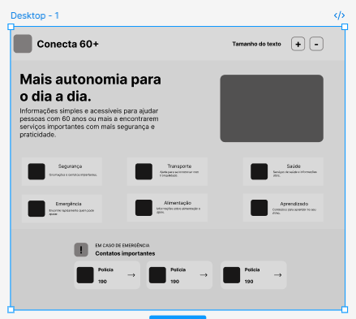
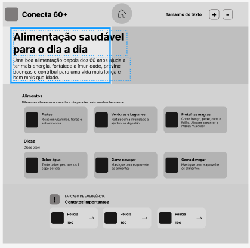
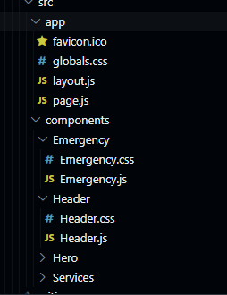
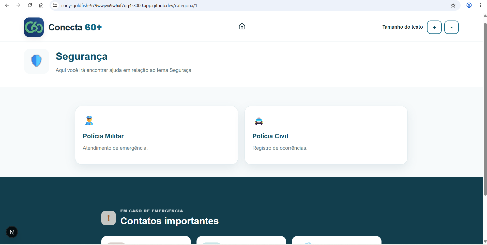

# WebMobile - Projeto
# Integrantes 

Gabriel Freitas 10435826
Gustavo Luigi Chao Pinotti 10419700
Henrique Akio Uehara 10771465
# Extensão
O projeto é extensionista pois seu objetivo é auxiliar a comunidade idosa a usar o celular e acessar serviços como segurança(cair em golpes) e utilizar serviços como o Uber, o que contribui para a inclusão digital deles.

# Wireframe
foi feito um wireframe do site que será na segunda etapa do projeto 

## Home do Wireframe

## Alimentação do Wireframe

## Exportação do projeto
O projeto foi exportado de um HTML, JavaScript e um CSS para dentro do Novo Projeto NextJS

## Componentização
A home page do projeto foi componentizada dentro do projeto de NextJS e esta é a estrutura de pastas e arquivos:

### Página dinámica
Aqui foi feita a pagina e a navegação dinamica para os 6 casos segurança, transporte...

